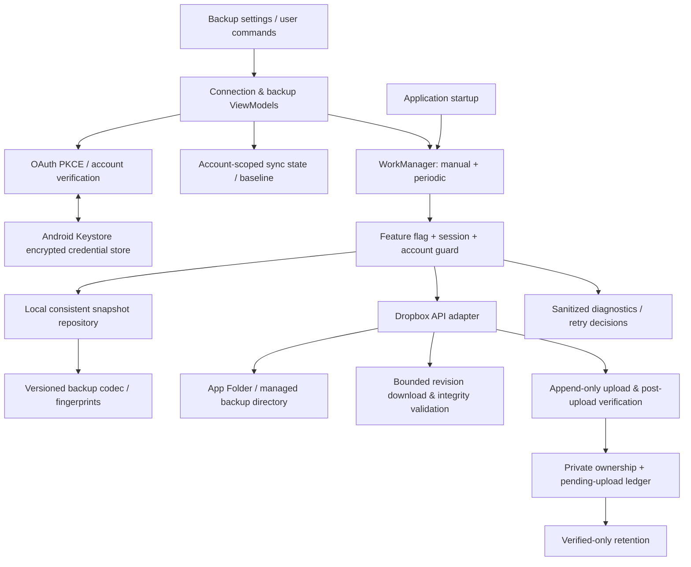

# Dropbox Connection & Backup Synchronization — Reusable Android Integration Guide

> **Purpose:** A practical, app-agnostic engineering playbook for adding a trustworthy Dropbox connection, manual/automatic backups, and safe synchronization to Android applications.
>
> **Audience:** Android/Kotlin developers, reviewers, QA engineers, and future app maintainers.
>
> **Scope:** Dropbox OAuth, secure credential handling, App Folder access, file serialization, upload/download verification, sync orchestration, retention, error handling, observability, testing, and release readiness.
>
> **Out of scope:** App-specific database schema, special installation/restore user journeys, product-specific conflict-dialog copy, and using Dropbox as a real-time database.
>
> **Reference:** Patterns and failures learned during LocalTell's Dropbox integration. Implementation details should be adapted—not copied unquestioningly—for each new application.
>
> **Reference code reviewed:** `actionanand/local-tell`, `feature/dropbox-backup-4b-m2`, commit `a624997` (24 October 2026 review context). This guide distinguishes existing design patterns from recommended future-app hardening. Check the target repository and current Dropbox SDK before implementation.

---

## 1. Core principles

Treat a cloud backup integration as a **recoverable data-transfer system**, not merely a Connect button and an upload API call.

1. **Connection is not backup success.** Successfully authenticating proves account access; backup success requires upload, download verification, ownership persistence, and honest status reporting.
2. **User data wins over cleanup.** If provenance, revision, or safety cannot be proven, retain the remote file—even when this exceeds a desired retention count.
3. **Backup != continuous two-way database sync.** Immutable snapshots and explicit conflict decisions are safer than silently overwriting databases.
4. **All operations are account- and session-scoped.** Work queued under one account must never run against another account after disconnect/reconnect.
5. **Network and API errors are different.** HTTP 400 is an invalid request, not a connectivity problem; most permanent 4xx errors should not be retried unchanged.
6. **Retry reads, not ambiguous writes.** After an upload might have succeeded, first reconcile its receipt and remote state. Do not blindly upload another copy.
7. **Data integrity before merging.** Verify downloaded revision, size, Dropbox content hash, backup schema, and application checksum before changing local data.
8. **Least privilege and privacy.** Use App Folder access, minimal scopes, short-lived access tokens with refresh capability, encrypted local credential storage, and appropriate backup-content encryption.
9. **Offline-first.** The local app must remain functional if Dropbox is unavailable, unlinked, or disabled.
10. **A feature switch is functional, not cosmetic.** Disabling cloud backup must stop queued and scheduled work, not merely hide settings UI.

### Invariants to preserve

- Never delete a manually uploaded, legacy, unrelated, modified, or unrecognized Dropbox file automatically.
- Never publish `Up to date` solely because an API request completed; verify the resulting backup and pending local changes.
- Never infer ownership from a folder or filename alone.
- Never classify a malformed request as a network outage.
- Never upload credentials, API tokens, or the ownership ledger inside a portable backup.
- Never merge corrupted or oversized backup data.
- Never silently overwrite newer remote snapshots.

---

## 2. Reference architecture



### Responsibility boundaries

| Component | Owns | Must **not** own |
|---|---|---|
| Connection controller | OAuth, consent, account verification, reconnect, disconnect | Backup merging and file deletion |
| Credential store | Encrypted token persistence, Keystore failures | Portable backup contents |
| Session store | Account identity, session generation, invalidation | Raw access tokens in logs/UI |
| Sync state store | Mode, timestamps, baseline fingerprint, pending, error, conflict | Treating an OAuth connection as successful sync |
| Backup repository | Consistent local snapshot, validation, transactional imports if offered | Dropbox SDK calls |
| Backup codec | Versioned serialization, limits, checksum, canonical fingerprint | Remote authorization |
| Dropbox adapter | Folder listing, uploads, revision downloads, metadata, conditional deletes | Domain-level merge decisions |
| Sync worker | Sequencing, cancellation checks, retries, conflict decisions | Unconditional replacement of data |
| Ownership ledger | Proof of uploads and pending-upload recovery | Guessing ownership by filename |
| Presentation | Status, diagnostics, explicit destructive confirmation | Direct network calls on main thread |

Prefer small interfaces around the provider (`RemoteStore`, `CredentialStore`, `BackupCodec`, `OwnershipStore`) so most safety tests can run with fakes.

---

## 3. Dropbox Developer Console setup

### 3.1 Create a separate Dropbox app identity for each product

In the [Dropbox App Console](https://www.dropbox.com/developers/apps), create a scoped app for the new product.

**Preferred content access:** **App Folder**. It grants access only to a dedicated location for that Dropbox app, normally shown to the user as `Apps / <Dropbox app display name>`. Within the API the app works relative to **its own folder root**.

**Do not assume** App Folder permissions can write to another app's folder or a shared umbrella path such as `Apps / <Umbrella> / <Other App>`; that would generally need a different permissions model. Do not request Full Dropbox access only to achieve a cosmetic folder layout. The Dropbox app registration controls the App Folder root, and the visible display name may differ by locale or user action.

### 3.2 Minimal scopes

A typical Android app that displays the connected account and manages its own backups uses:

```text
account_info.read
files.metadata.read
files.content.read
files.content.write
```

Grant the minimal corresponding scopes in the Dropbox developer console **and** request/validate the needed scopes during authorization. Do not assume enabling scopes in the console automatically changes authorization already granted to older tokens. Reauthorization may be required when scopes change.

### 3.3 App key and OAuth redirect

- The Dropbox **App Key** is a public OAuth client identifier; it may be bundled in Android build configuration.
- **Never embed a Dropbox App Secret** in a mobile application.
- Use the official Android/Java SDK's PKCE authorization flow.
- Register the SDK-provided OAuth redirect handling as required by your version. A commonly used Android SDK pattern includes `com.dropbox.core.android.AuthActivity` and a manifest intent-filter scheme `db-${dropboxAppKey}`.
- Check intent routing, `android:exported`, and callback behavior for debug/release variants and process recreation.
- Include internet/network-state permissions where required for the application; Dropbox connection itself must not need location, SMS, contacts, or broad media permissions.

### 3.4 Background authorization

For background backups on a mobile client, use **Authorization Code + PKCE**, request offline access/refresh-token capability as supported by the SDK, and let the SDK refresh short-lived access tokens. Do not design scheduled backups around a one-time access token that expires before the next job.

**Reference:** [Dropbox OAuth guide](https://docs.dropboxapi.com/dropbox-api/docs/oauth), [developer guide](https://docs.dropboxapi.com/dropbox-api/docs/developer-resources/developer-guide).

---

## 4. OAuth connection lifecycle

### 4.1 Recommended state model

```text
NOT_CONNECTED
   └── User chooses Connect → CONNECTING
          ├── Auth success + scopes valid + saved credential + verified account → CONNECTED
          ├── User cancels → NOT_CONNECTED
          ├── Invalid consent/scope/token → REAUTHORIZATION_REQUIRED or NOT_CONNECTED
          ├── Credential storage error → FAILED (storage)
          └── Temporary network/API failure → FAILED (retry verification)

CONNECTED
   ├── Token refresh handled by SDK when possible
   ├── Revoked/invalid authorization → REAUTHORIZATION_REQUIRED
   └── User confirms Disconnect → DISCONNECTING → NOT_CONNECTED
```

### 4.2 Safe connection sequence

1. Enter a new **authorization generation**; invalidate stale account-specific sync sessions when a new authorization replaces an earlier account.
2. Launch OAuth PKCE, preferably through the official SDK.
3. Handle callback once, including cancellation, process restart, and duplicate intents.
4. Require a nonempty credential and any scopes the app actually needs.
5. Save access/refresh credentials with **Android Keystore-backed AES-GCM** or equivalent suitable secure storage.
6. Verify account identity (`users/get_current_account` or SDK equivalent) rather than inferring it from UI callback text.
7. Persist **account identity hash + credential tag + session generation** for work binding; never store raw token material in those state records.
8. Mark CONNECTED **only after** durable credential storage and account verification succeed.
9. Schedule work only after successful account activation and when the configured mode permits it.

### 4.3 Secure credential handling

- Use authenticated encryption (AES-GCM), a unique random nonce/IV per encryption, and a key managed by Android Keystore.
- Handle permanently invalidated keys or malformed ciphertext without pretending a prior token is usable; separately handle transient Keystore failures without deleting potentially valid credentials.
- Do not include token values, authorization headers, refresh tokens, or encryption keys in a debug report, portable backup, crash log, or clipboard contents.
- Credentials are specific to an application installation and account. A portable backup should not silently transplant another user's Dropbox authorization.
- For apps with Android auto-backup enabled, exclude encrypted credentials and device-bound key-dependent metadata from system restore or explicitly design secure migration.

### 4.4 Disconnect is not delete

Disconnect should:

1. Ask for confirmation.
2. Immediately invalidate the active sync session.
3. Cancel pending manual and periodic work.
4. Attempt Dropbox token revocation when supported, then clear local credentials.
5. Report a revocation failure truthfully; locally disconnected does not always mean revocation could be confirmed.
6. **Leave Dropbox files and local application data untouched.**

Cancellation cannot reverse a network request already accepted by Dropbox. A partially completed upload may leave an extra immutable file. Keep it for safe reconciliation instead of guessing which file to delete.

---

## 5. Storage layout and backup format

### 5.1 Provider folder layout

The Dropbox App Folder root is controlled by the Dropbox app registration. Create a dedicated **managed** subdirectory within that root, such as:

```text
Apps/
└── <Dropbox app display name>/          # Dropbox-controlled app-folder root
    └── <app-managed-backups>/            # API path: /<app-managed-backups>
        ├── <AppName>-<date>-<unique-id>.backup
        ├── <AppName>-<date>-<unique-id>.backup
        └── ...
```

The application sends paths relative to its App Folder, e.g., `/<app-managed-backups>/<filename>`. It should **not** prepend `Apps / ...` to API paths.

**Folder handling:** An absent managed folder means *no app-managed files yet*. Treat a typed path-not-found listing result as empty. Create the directory at upload time, and handle a concurrent folder-creation conflict only if a subsequent metadata check confirms the destination really is a folder. Other errors (not a folder, permission denied, quota exceeded) must propagate.

### 5.2 Backup envelope

Each app owns its own domain schema; do not copy another app's `savedPlaces`/`journeys` payload. A suggested general structure:

```json
{
  "format": "<app-id>-backup",
  "schemaVersion": 1,
  "createdAt": "<UTC ISO-8601 timestamp>",
  "payload": "<canonical or serialized application data>",
  "checksum": "<SHA-256 of defined payload bytes>"
}
```

Set a unique filename pattern and dedicated file extension per app. Validate **both** the name and body; a correct extension never proves a valid backup. Include documented schema migrations or reject unsupported versions clearly. Exclude credentials, auth headers, and device-specific secrets.

### 5.3 Bounds and data integrity

Before allowing a remote file to affect local data:

- Check the server-advertised size against a **per-app maximum**.
- Cap the bytes **while streaming**, even if metadata is wrong; never download an unbounded body into a `ByteArrayOutputStream` first.
- Match the actual received count to the listed size.
- Validate server `id`, `rev`, and file size against the listing; compare server content hash when available.
- Calculate and compare **Dropbox's content hash**, which differs from ordinary whole-file SHA-256: split into **4 MiB** blocks, SHA-256 each block, concatenate the raw digest bytes, then SHA-256 that concatenation. For an empty file, hash the empty concatenation.
- Parse strict UTF-8 and bounded structured data; reject duplicate keys, invalid types, unsupported versions, oversized arrays, bad dates, and corrupt checksums.
- Where the product supports restore/import, finish validation before database mutation and commit changes atomically.

**Sizing example:** LocalTell uses **12 MiB** for its `.bklt` file, based on its record ceilings. **12 MiB is not a Dropbox universal limit**; determine the correct cap for each new app and prove the maximum valid payload fits.

**Reference:** [Dropbox content hash specification](https://docs.dropboxapi.com/dropbox-api/docs/technical-reference/content-hash).

### 5.4 Backup privacy

Dropbox connection transport security and encrypted **OAuth credentials** do **not** mean backup file contents are end-to-end encrypted. For private or sensitive data, strongly consider application-layer authenticated encryption (e.g., a well-designed versioned envelope using AES-GCM and a recoverable key strategy). Define how the user restores keys, rotates keys, and recovers from lost devices. Never imply encryption where none is implemented.

A checksum alone detects accidental corruption; without a keyed authenticity mechanism it does **not** prevent a malicious party with file access from replacing both content and checksum. Clearly disclose the data categories backed up, destination, encryption status, and user control.

---

## 6. Revision-pinned downloads: the critical Dropbox API lesson

**Pitfall encountered:** An Android backup worker authenticated successfully but received:

```text
Stage: DOWNLOAD_REMOTE
Exception: BadRequestException
Category: BAD_REQUEST
Retryable: false
```

The offending SDK call combined a file-ID path with the separate/deprecated revision option:

```kotlin
// Incorrect pattern for this integration: can produce an invalid API request.
client.files().downloadBuilder(file.id).withRev(file.revision).start()
```

For a specific Dropbox file version, use the revision as the **path argument**:

```kotlin
// Expected Dropbox API argument: {"path":"rev:<revision>"}
client.files().downloadBuilder("rev:${file.revision}").start().use { download ->
    // Verify response metadata, bound body bytes, validate content and close downloader.
}
```

Do **not** send the deprecated separate `rev` parameter alongside the revision path. Validate a revision identifier according to the API/SDK contract before making the request; do not concatenate untrusted arbitrary values.

Important distinctions:

- `"/directory/file.backup"` — normal API-relative file path.
- `"id:<file-id>"` — a file-ID addressed path.
- `"rev:<revision>"` — a specific immutable file revision.
- A full HTTPS sharing link or a physical `Apps/...` location is **not** a valid `path` argument.

The same revision-pinned downloader should be used for both **reading an existing remote snapshot** and **verifying a just-uploaded snapshot**. Always validate the returned file ID, revision, size, received bytes, content hash, and application backup format. Close download streams even if parsing fails.

**Recommended regression test:** Use a fake HTTP transport under the **real SDK client** and assert the request arguments contain exactly one field:

```json
{"path": "rev:<revision>"}
```

Do not rely only on a mocked helper that never serializes the actual SDK request.

**References:** [Dropbox Java SDK documentation](https://dropbox.github.io/dropbox-sdk-java/), [API download endpoint](https://www.dropbox.com/developers/documentation/http/documentation#files-download).

---

## 7. Backup upload and verification lifecycle

### 7.1 Safe sequence

```mermaid
sequenceDiagram
    participant W as Backup worker
    participant L as Local repository
    participant D as Dropbox
    participant O as Ownership ledger
    W->>O: Validate existing ledger and pending receipt
    W->>D: List managed remote snapshots
    D-->>W: Metadata + revision + content hash
    W->>L: Take consistent local snapshot
    L-->>W: Validated data + stable fingerprint
    W->>D: Append new unique file (no overwrite)
    D-->>W: Upload metadata
    W->>O: Save pending upload receipt
    W->>D: Download rev:<uploaded-revision>
    D-->>W: Revision-pinned bytes + metadata
    W->>W: Verify metadata, size, hash, backup schema, fingerprint
    W->>O: Record verified ownership
    W->>D: Re-list; detect concurrent changes
    W->>D: Conditionally delete provably owned obsolete files (if safe)
    W->>O: Update / clear pending receipt
    W->>L: Compare fresh local fingerprint with uploaded snapshot
    W->>W: Publish success or pending changes
```

### 7.2 Step-by-step contract

1. **Validate feature, session and account.** Check cancellation at boundaries and before any remote write.
2. **Preflight local storage.** Ownership record and pending-upload receipt must be readable. Do not start a new upload when they are corrupted.
3. **List remote snapshots.** Handle pagination; distinguish an absent folder from an inaccessible/non-folder path.
4. **Select a baseline.** Use a stable, app-defined fingerprint excluding volatile fields (export time, local auto-increment IDs) and track the last common baseline for divergence detection.
5. **Take a consistent local snapshot.** Read all related datasets in a transaction or equivalent consistent read. Validate before encoding.
6. **Create an immutable new file.** Use a unique name and `ADD` / no-overwrite semantics. If supported, enable strict conflict checking; do not reuse a path to replace a prior backup.
7. **Persist a pending receipt** with uploaded ID, revision, path, size, content hash, fingerprint, and pre-upload remote-state token.
8. **Download exactly the uploaded revision.** Run the full provider and application integrity checks.
9. **Record ownership only after verification.** A successful upload response alone is insufficient proof of successful backup.
10. **Re-list remote state.** Detect new or changed remote snapshots; a simultaneous remote write should stop unsafe cleanup and enter a recoverable state.
11. **Prune only provably owned obsolete files**, with a fresh metadata/revision check immediately before each delete.
12. **Publish status against a fresh local snapshot.** If local content changed during transfer, report `Pending changes` instead of `Up to date`.

### 7.3 Ambiguous upload and retry recovery

The most dangerous failure window is **after Dropbox accepts a write but before the app knows or stores the result**.

- If an upload response exists and is durably stored, resume by verifying that exact file/revision—**do not upload a second copy**.
- If the pending receipt is unreadable or its remote file changed, stop; retain remote files and surface a recoverable error/conflict. Never fabricate ownership.
- If network failure occurred after upload began, do not automatically retry a new upload without reconciliation.
- If the process died before its upload receipt was persisted, an orphan snapshot may exist. Preserve it unless ownership can be independently, cryptographically/operationally established under a documented protocol.
- If cleanup fails after verification, retain the pending state and resume safely; do not mark retention complete or delete arbitrary files on the next attempt.

An operation may temporarily leave **more than the configured count** of backup files; preservation takes priority over forcing an exact number.

---

## 8. Ownership-only retention and non-deletion guarantees

### 8.1 Ownership must be affirmative

Use a private, integrity-protected, per-account ledger containing enough information to match a successful upload to current Dropbox metadata:

```text
accountHash
fileId
revision
path
size
contentHash
verifiedAt / upload order
```

For an automatic delete to be eligible, require all relevant fields to match, including **current** metadata immediately before deletion. A file with an identical filename or inside a managed folder is still **not automatically owned**.

### 8.2 Retention algorithm (example: latest 3)

```text
eligible = remoteFiles.filter(
    currentMetadata exactly matches a verified ownership ledger entry
)

if newest just-verified upload is not positively owned:
    do not delete anything
else:
    retain newest 3 eligible files, always including just-verified upload
    for each older eligible file:
        re-list/check remote changes
        re-read its metadata and verify revision + identity
        conditional delete using file ID and revision
        durably update ownership and pending-cleanup progress
```

Never:

- Delete a manually uploaded file.
- Delete root-level, legacy, unknown, foreign-device, moved/replaced, or externally modified files without the required proof.
- Delete by matching a filename prefix, extension, timestamp, or directory alone.
- Delete an entire folder or recursively clean arbitrary Dropbox paths.
- Delete after an unsuccessful upload or verification.
- Guess which orphan to delete when local ownership metadata is lost.

**Why count can exceed 3:** Ownership is normally scoped to one app installation. Device data removal, corruption, or multiple installations may leave files without locally verifiable provenance. Keep them. A retention cap is best-effort over the **owned set**, not a license to purge the folder globally.

---

## 9. Sync modes and scheduling

| Mode | Behavior | Scheduler treatment |
|---|---|---|
| Off | No cloud uploads or scheduled sync; local use remains available | Cancel unique Dropbox jobs |
| Manual only | Upload/check only after explicit Sync now | No periodic job |
| Daily | Periodic attempt; explicit Sync now also allowed | Unique periodic job, approximately 1 day |
| Weekly | Periodic attempt; explicit Sync now also allowed | Unique periodic job, approximately 7 days |

Android WorkManager is **opportunistic**, not a precise alarm. Use network constraints and exponential backoff where appropriate. Battery optimizations and connectivity may delay execution.

- Manual and periodic work should use one serial synchronization implementation (mutex plus unique work names/session checks), not separate business logic.
- Make periodic job names deterministic and enforce one active schedule per app/account policy.
- Use generation IDs so work started for an earlier connection cannot operate under a new one.
- Re-check feature flag, account, generation, authorization and mode **inside the worker**, not just when enqueuing.
- Never perform long Dropbox network work on the main/UI dispatcher.
- Cancel work on disconnect, account switch, mode Off, or cloud feature disablement.
- Keep local changes marked pending if scheduling is delayed.

### Build-time kill switch

Suggested app configuration:

```json
{
  "enableCloudBackup": true
}
```

Expose it as a build-time boolean (e.g., `BuildConfig.ENABLE_CLOUD_BACKUP`). Reject JSON strings such as `"true"` where a boolean is required.

When `false`:

- Hide all cloud backup UI and do not create provider-specific UI models unnecessarily.
- Do not initiate/complete Dropbox OAuth or enqueue new work.
- Cancel previously scheduled manual and periodic work at startup.
- Guard the worker entry point so **stale work does not access Dropbox**.
- Preserve credentials, account/session metadata, ownership records, remote files and local data (unless the product explicitly defines a separately consented disconnect action).
- Leave manual/local backup and restore functionality available.

When re-enabled, use the normal credential verification and scheduling rules. For environments that must ship with the feature permanently disabled, decide whether the build must also omit Dropbox SDK/manifest registration and configuration dependencies—hiding UI alone is not an attack-surface reduction.

---

## 10. Generic synchronization decisions

A **stable content fingerprint** and a **last common baseline fingerprint** are different from a Dropbox file checksum:

- **Backup checksum:** validates bytes inside a serialized backup.
- **Dropbox content hash:** validates bytes against provider file metadata.
- **Application fingerprint:** compares semantic data, excluding volatile export timestamp and local row IDs.
- **Baseline fingerprint:** records the common data version after an acknowledged successful sync.

A reusable conservative decision function is:

```text
if remote fingerprint == local fingerprint:
    data is semantically equal
    BUT successful app-managed sync still requires a verified owned backup

else if remote is absent AND there is no contradictory baseline:
    first normal upload is allowed

else if remote matches the common baseline AND local differs:
    local-only changes can produce a new verified snapshot

else:
    remote and local differ in a way requiring explicit product policy
    do not silently overwrite either side
```

The exact product policy for merging data is **not generic**: whether to union items, deduplicate records, preserve IDs, or trim history depends on the app's schema. Place it behind an application-specific domain policy. At the provider layer, never silently replace an immutable remote snapshot.

**Race limitation:** Dropbox does not offer an atomic compare-and-swap of a *whole folder*. Rechecking before/after upload and before deletion limits accidental conflicts, but cannot eliminate every cross-device race. Treat this as **safe snapshot backup**, not perfect instantaneous database synchronization.

---

## 11. Failure classification and operational playbook

### 11.1 Diagnostic stages

Emit one of these stages for each relevant network/storage operation:

```text
VERIFY_ACCOUNT
LIST_REMOTE
PREPARE_BACKUP_FOLDER
DOWNLOAD_REMOTE
READ_LOCAL_DATA
UPLOAD_BACKUP
VERIFY_UPLOAD
RECORD_OWNERSHIP
RETENTION_CLEANUP
COMPLETE
```

Each failed attempt should capture a minimal **sanitized** diagnostic:

```text
Cloud backup diagnostic
Stage: DOWNLOAD_REMOTE
Exception: BadRequestException
Category: BAD_REQUEST
Request ID: <Dropbox request id, if available>
Retryable: false
Timestamp UTC: <ISO-8601 or epoch milliseconds>
Detail: <short, redacted API argument explanation if safe>
```

Use `X-Dropbox-Request-Id` (or the SDK's request ID) for provider support. Do **not** attach bearer tokens, raw request headers, full file paths, user data, backup payloads or raw exception text without redaction.

### 11.2 Error matrix

| Error / symptom | Typical cause | Classification and behavior | Safe recovery |
|---|---|---|---|
| HTTP **400** / `BadRequestException` | Invalid `Dropbox-API-Arg`, wrong `path` format, unsupported/deprecated request field | **Permanent request error; do not retry unchanged** | Inspect stage, SDK request serialization and sanitized API response; fix arguments |
| HTTP **401**, invalid/revoked token | Expired invalid authorization or revoked connection | Reauthorization required; avoid endless retries | Refresh via SDK if applicable; otherwise prompt reconnect |
| HTTP **403** | Insufficient scopes, forbidden operation, account limitations | Permission/account issue; generally do not rapidly retry | Check requested/granted scopes and endpoint access |
| HTTP **409** typed path-not-found | Target folder absent | Expected only for folder discovery; not an internet outage | Treat absent managed folder as empty; create for first upload |
| HTTP **409** path conflict / not-folder | File occupies folder path or concurrent creation | Path issue; distinguish known safe creation race | Re-read metadata, accept only a real folder |
| HTTP **409** revision mismatch | Remote file changed between listing and operation | Conflict / stale metadata | Re-list; keep files; repeat decision safely |
| HTTP **409** write/no-permission | Missing `files.content.write` or restricted folder | Non-retryable until scope/account fixed | Verify scopes and access; reconnect if needed |
| Dropbox quota / insufficient space | Account full | Quota issue, not network | Inform user; do not delete their other files automatically |
| HTTP **429** | API or namespace write rate limiting | Retryable with delay; respect `Retry-After` | Exponential backoff; reduce excessive requests |
| HTTP **5xx**, temporary SDK server exception | Dropbox outage/transient server failure | Limited retry before ambiguous write | Backoff; reconcile any in-flight upload first |
| `NetworkIOException` / stream reset | Connectivity dropped or transfer interrupted | Transport error, potentially retryable for safe reads | Retry bounded read; do not blindly duplicate writes |
| DNS/TLS/timeout exception | Network, certificates, device clock, proxy | Diagnose transport vs security failure separately | Check environment, clock, cert chain; never bypass TLS checks |
| `DownloadErrorException` | File absent, unsupported, no access, malformed request | Inspect tagged SDK variant, not generic network | Branch on typed error; preserve remote state |
| File ID/revision/size mismatch | Remote file changed after listing or stale response | Stale snapshot; stop verification | Re-list and compare, never merge stale bytes |
| Dropbox `content_hash` mismatch | Corrupted/incomplete/tampered transfer or metadata mismatch | Validation error; no database write | Re-read only if safe; preserve original |
| Download over configured size | Oversize file or dishonest metadata | Validation failure, usually non-retryable | Reject early and during stream; no local mutation |
| Invalid filename/schema/JSON/checksum | Corrupted, foreign, unsupported or adversarial backup | Validation error | Reject; preserve file; request explicit support action |
| Android Keystore unavailable | Temporary key store/provider failure | Local credential storage failure | Retry safe verification; avoid deleting potentially valid ciphertext |
| Permanently invalid key / auth-tag failure | Device-bound key or ciphertext unusable | Credential must be reauthorized | Clear unusable credential safely; do not delete Dropbox data |
| Ownership ledger unreadable | Damaged local metadata | **Fail closed before upload and delete** | Preserve remote files; surface safe recovery guidance |
| Pending-upload receipt unreadable | Corrupt interrupted-upload journal | **Do not create another upload blindly** | Pause and investigate; preserve all remote files |
| Crash after upload accepted | App never stored result/receipt | Ambiguous write | Reconcile known state; preserve any unprovable orphan |
| Cancellation/account switch mid-transfer | User disconnected or changed account | Stop local progression and future mutations | Re-check session, preserve accepted remote files |
| Local database changed during upload | User activity continued | Backup may be valid but no longer current | Mark `Pending changes`; attempt another scheduled sync |
| Cleanup partially completed | Some obsolete owned files deleted, ledger not fully updated | Recoverable retention state, not full success | Resume using durable progress, reverify metadata |
| Background job never runs on time | Doze/battery/network constraints | Scheduling delay, not necessarily failure | Explain approximate cadence; retain pending status |
| Backup mode Off / feature flag disabled | User or build configuration disables cloud | Expected no-op, not an error | Cancel work; leave local/remote data alone |

For Dropbox SDK tagged-union errors, check the tag predicate **before accessing the variant**. For example, check `isPath` before `pathValue`. Otherwise, the error handler may throw a new exception and conceal the original Dropbox error. A classification fallback must itself be non-throwing.

### 11.3 Retry policy

| Operation type | Retry policy |
|---|---|
| Credential/account read | Retry only when failure is transient; bound attempts |
| Remote list / metadata read | Limited retries for network, rate-limit and server errors |
| Revision-pinned download | Limited retries for transient transport; abort on malformed request or invalid backup |
| Folder creation | Conditional retry only for known concurrent creation / transient provider failure |
| Upload before request sent | May retry if confirmed no remote write occurred |
| Upload may have reached Dropbox | **Reconcile uploaded file/receipt first**; no blind second upload |
| Post-upload verification | Resume same uploaded revision when possible |
| Deletion / retention | Never retry deletion without fresh ownership and revision verification |

Observe `Retry-After` when available; use exponential backoff with jitter and a small retry ceiling. Dropbox's official guide says HTTP 400 retries do not fix invalid requests, while 429 and transient 5xx merit backoff. **Reference:** [Dropbox Error Handling](https://docs.dropboxapi.com/dropbox-api/docs/error-handling), [Performance / rate limiting](https://docs.dropboxapi.com/dropbox-api/docs/performance).

---

## 12. Diagnostics, security and privacy reviews

### Good user-facing statuses

- Not connected / Connecting / Connected
- No cloud backup yet
- Syncing
- Up to date
- Pending changes
- Backup failed (with actionable category)
- Offline
- Reconnect required
- Conflict / user action required
- Backup interrupted

Show **last successful** and **last attempted** times separately. Never overwrite `last successful` on failure. Offer a **Copy diagnostic details** action on failure, but keep ordinary settings concise.

### Safe diagnostic fields

Recommended: stage, known exception class, short categorical tag, request ID, UTC timestamp, retryable boolean, app version/build identifier, SDK version (if known).

Avoid: raw URL query strings, auth codes, tokens, complete exception messages, full remote paths, personal names, location records, financial data, and backup content. If the provider's HTTP 400 body echoes request arguments, redact `id:`, `rev:`, `ns:` and path-like tokens before saving or displaying it. This is a starting point; validate the redactor against representative real error bodies and err on the side of omitting details.

### Security checklist

- App Folder rather than Full Dropbox where possible.
- Only necessary scopes, and actual granted-scope validation.
- PKCE and refresh tokens for unattended mobile backup.
- Android Keystore-encrypted stored tokens, not plaintext shared preferences.
- HTTPS with normal certificate validation; no global trust-all hacks.
- No credentials in portable backups, logs, user diagnostics or screenshots.
- Appropriate user disclosure and, for sensitive content, application-layer backup encryption with a recovery strategy.
- Strict bounded parsing and streamed download size enforcement.
- No automatic destructive behavior outside positively verified owned backups.
- Account/session generation checks before write/delete operations.

---

## 13. Test strategy — build gates vs. live-service gates

### 13.1 Unit and SDK-contract tests

Test pure policies and use fake interfaces where possible:

- Scope validation and malformed OAuth results.
- Stale OAuth callbacks, disconnect races and different-account session invalidation.
- Encrypted credential storage failure categories (use instrumentation where Keystore required).
- Absent folder; concurrent creation; path-is-file; non-path error variants.
- The **real Dropbox SDK request arguments** through a fake HTTP transport, especially revision-pinned `files/download` and no separate deprecated `rev` parameter.
- Correct Dropbox 4 MiB block-hash implementation, including empty and >4 MiB payloads.
- Metadata mismatch, truncated response, wrong content hash, oversize metadata and streaming overflow.
- Unknown/manual files are excluded from delete eligibility.
- Fourth/fifth app-owned upload retains exactly the last three owned verified copies.
- Ownership ledger corruption blocks upload/deletion before remote mutation.
- Failed upload, failed verify, failed ownership write, interrupted cleanup and deterministic retry recovery.
- Conflict detection when another device uploads while a run is active.
- Local edits during upload keep `Pending changes`.
- Retryable vs. permanent error classification and sanitization.
- Feature flag enabled and disabled behavior.
- Localization resource keys, formatting and accessibility copy.

### 13.2 Android instrumentation tests

Run on an emulator/device (compiling an `androidTest` APK does **not** execute it):

- Database snapshot consistency with concurrent writes.
- Cancellation and transactional rollback behavior.
- Actual Android Keystore credential encryption and key invalidation.
- WorkManager startup/cancellation and persistence across process restart.
- Account changes and screens/dialog dismissal during network operations.
- Large fonts, dark/light themes, accessibility focus and button visibility.

### 13.3 Disposable Dropbox account end-to-end tests

Use a **test Dropbox account**, not a personal primary account, for operations that intentionally simulate failures or deletions.

1. Connect, verify account identity and requested scopes.
2. Perform first manual backup with empty managed folder; confirm folder creation.
3. Validate upload, revision download and content hash match.
4. Check `last successful` and ensure any local edits become pending.
5. Repeat with scheduled mode; confirm background execution is opportunistic.
6. Upload four/five app-managed backups; confirm only eligible owned files are pruned.
7. Add an unrelated file and a manually uploaded backup with a matching-looking filename; confirm neither is deleted.
8. Simulate quota error, invalid token, missing directory, rate limiting, network interruption and account switch.
9. Interrupt verification after upload and check that retry does **not** create an unnecessary duplicate.
10. Install a build with cloud backup disabled; confirm UI hidden, work cancelled, **no remote API calls**, no file deletion, and local backup still works.
11. Re-enable cloud backup; verify normal account verification and safe resumption.
12. Exercise recovery from corrupted metadata using copies of a test data set, without forcing a destructive reset.

### 13.4 Definition of done

Release only when:

- [ ] Unit tests, Android lint and release/R8 build succeed.
- [ ] SDK HTTP request serialization is tested, not just high-level mocks.
- [ ] At least one actual connected-device backup is uploaded **and revision-verified**.
- [ ] Ownership-only retention has been proven on disposable test files.
- [ ] Manual/unrelated Dropbox files survive all retention scenarios.
- [ ] Interruptions and retries cannot silently duplicate writes or lose conflict state.
- [ ] App-level privacy disclosure matches the actual backup content/encryption.
- [ ] Disabled-feature build prevents provider operations without deleting user data.
- [ ] Remote and local data remain usable when Dropbox is unavailable.
- [ ] Support diagnostics identify the failing stage without exposing secrets.

---

## 14. Reuse checklist for the next Android application

### Phase A — define app-specific policy

- [ ] Decide the datasets, backup schema, size/record ceilings and migration policy.
- [ ] Decide whether application-layer backup encryption is required; define key recovery.
- [ ] Define domain-specific fingerprint and optional import/merge policies.
- [ ] Define backup retention count and explicit safety invariants.
- [ ] Decide whether Sync now, Daily and Weekly modes are all required.
- [ ] Define how the cloud feature can be disabled without deleting stored data.

### Phase B — establish Dropbox identity

- [ ] Create new Dropbox App Folder application for the product.
- [ ] Assign only required scopes; test actual granted scopes.
- [ ] Add PKCE Android redirect handling and offline-refresh capability.
- [ ] Store credentials with Keystore authenticated encryption.
- [ ] Verify real account identity and bind a session generation to it.

### Phase C — implement transport + safety

- [ ] Create managed subdirectory relative to App Folder root.
- [ ] Implement provider adapter and pagination.
- [ ] Implement versioned codec and strict bounded validation.
- [ ] Implement revision-path downloads `rev:<revision>`.
- [ ] Verify returned metadata, bytes and Dropbox content hash.
- [ ] Implement append-only upload + receipt + post-upload verification.
- [ ] Implement private per-account ownership ledger and conditional deletion.
- [ ] Implement canonical fingerprint, baseline and conservative sync decision policy.
- [ ] Implement WorkManager scheduling, session guards and error categorization.

### Phase D — ship and operate

- [ ] Add concise status UI and sanitized Copy Diagnostic action.
- [ ] Test all permanent and transient Dropbox API errors.
- [ ] Test live Dropbox against disposable data, including intentionally unrelated files.
- [ ] Verify disabled-feature mode and local-data independence.
- [ ] Document current scopes, SDK version, folder paths, schema and support playbook.
- [ ] Verify user-facing claims about encryption, retention and backup success.

---

## 15. Practical lessons to remember

| Anti-pattern | Why it fails | Safer pattern |
|---|---|---|
| Assuming Connect means backup works | OAuth never exercises file downloads/writes | Separate account connection and verified backup statuses |
| Categorizing every `DbxException` as `NETWORK` | API 400/path/permission errors are mislabeled and pointlessly retried | Typed SDK exception classification + stage diagnostics |
| `downloadBuilder(file.id).withRev(file.rev)` | Deprecated separate revision handling can make request invalid | `downloadBuilder("rev:${file.rev}")`; verify wire format |
| Trusting remote size only after body download | Remote can exhaust memory first | Metadata cap + bounded streaming output |
| Trusting backup checksum alone | It is neither Dropbox provider hash nor encryption | Verify provider hash + strict schema + application checksum; encrypt if needed |
| Deleting by `prefix + .extension` | User files can imitate that name | Private verified ownership record + revision-conditional delete |
| Pruning immediately after upload response | Upload can be wrong/incomplete/unverified | Download and validate uploaded revision first |
| Blindly retrying upload after timeout | Write may already have succeeded | Persist and reconcile pending-upload receipt |
| Sync work not account-scoped | Old jobs can run under newly connected account | Account hash + credential tag + generation guards |
| Feature flag only hides UI | Old WorkManager jobs can still run | Startup cancellation + worker entry guard |
| Declaring success while local edits continue | Upload is already stale | Compare fresh local fingerprint; preserve pending state |
| Tests compile but never touch Dropbox | SDK serialization/runtime errors remain invisible | Fake HTTP SDK wire test **and** disposable-account device test |

---

## 16. Official references and versioning

Recheck Dropbox docs when upgrading the SDK or changing app scopes. API behavior, generated Java SDK types, OAuth settings and supported Android versions may evolve.

- [Dropbox developer guide — app types, App Folder access and least privilege](https://docs.dropboxapi.com/dropbox-api/docs/developer-resources/developer-guide)
- [Dropbox OAuth guide — PKCE and refresh tokens](https://docs.dropboxapi.com/dropbox-api/docs/oauth)
- [Dropbox API v2 HTTP reference — files/download](https://www.dropbox.com/developers/documentation/http/documentation#files-download)
- [Dropbox Java SDK and version-specific Javadocs](https://dropbox.github.io/dropbox-sdk-java/)
- [Dropbox content hash algorithm](https://docs.dropboxapi.com/dropbox-api/docs/technical-reference/content-hash)
- [Dropbox error-handling guide](https://docs.dropboxapi.com/dropbox-api/docs/error-handling)
- [Dropbox API performance and rate limits](https://docs.dropboxapi.com/dropbox-api/docs/performance)
- [Dropbox App Console](https://www.dropbox.com/developers/apps)

### Optional implementation reference: LocalTell

The reusable responsibilities map approximately to the following files in the original Android implementation:

| Reusable concern | LocalTell reference file |
|---|---|
| App-specific build flag | `app-config.json`, `app/build.gradle.kts`, `CloudBackupFeature.kt` |
| OAuth scopes | `DropboxAuthorization.kt` |
| OAuth lifecycle and Keystore credentials | `DropboxConnection.kt` |
| Sessions / account binding | `DropboxBackupSessionStore.kt` |
| Scheduler and persistent sync state | `DropboxBackupState.kt` |
| Worker orchestration and provider adapter | `DropboxBackupWorker.kt` |
| Safe folder handling | `DropboxBackupFolder.kt` |
| Revision downloads and hash checks | `DropboxRevisionDownload.kt`, `DropboxDownloadLimit.kt` |
| Verified upload and safe retention | `DropboxVerifiedUpload.kt`, `DropboxBackupPolicy.kt`, `DropboxBackupOwnership.kt` |
| Diagnostics | `DropboxBackupDiagnostics.kt` |
| Backup schema and local transactions | `AppBackupCodec.kt`, `AppBackupRepository.kt` |
| Tests | `app/src/test/.../dropbox/` and `app/src/androidTest/.../dropbox/` |

These are **examples of separation of responsibilities**, not a library API or a promise that the target app can reuse the same data schema. Do not import another product's file format, encrypted preferences, account identity, or SQLite assumptions.

---

**Engineering rule:** _Do not treat a backup as successful until its exact remote revision has been downloaded and validated. Do not delete a file until your application can prove it owns that unchanged file. When in doubt, preserve data and report the actual failure stage._
